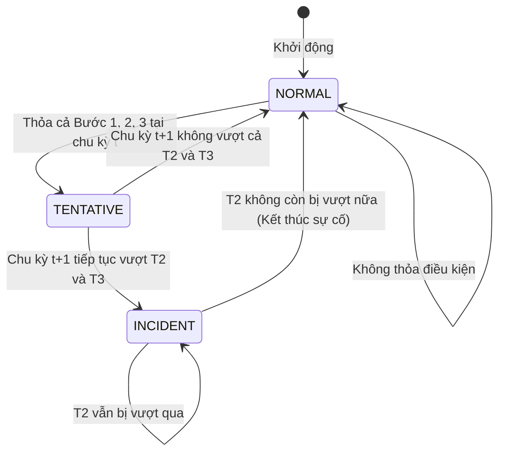

# Đối Chiếu Chi Tiết Giáo Trình & Slide Bài Giảng: Thuật Toán California #1

Tài liệu này trích xuất nguyên văn, phân tích ngữ nghĩa và tính toán đối chứng từng trang tài liệu phục vụ đề tài môn học **Hệ Thống Giao Thông Thông Minh (ITS)**:

* **Tài liệu 1:** [Bài giảng 03: Quản lý sự cố giao thông - TS. Lê Văn Quốc Anh](file:///d:/ITS/ITSgrXM/docs/Bai_giang_03_Quan_ly_su_co_TS_Le_Van_Quoc_Anh.pdf)
* **Tài liệu 2:** [Giáo trình Hệ thống Giao thông Thông minh - TS. Văn Hồng Tấn](file:///d:/ITS/ITSgrXM/docs/Giao_trinh_ITS_TS_Van_Hong_Tan.pdf)

---

## 1. Trích Dẫn Chi Tiết Slide Bài Giảng (TS. Lê Văn Quốc Anh)

### Slide 41 (Mã slide: `Bài giảng 03.36`) — Khái quát Giải thuật California
> **Nội dung nguyên văn trên slide:**
> * **Giải thuật California**
>   * Đây là một trong những giải thuật AID kiểu so sánh ra đời sớm nhất
>   * Thường dùng làm tiêu chuẩn để so sánh và đánh giá các giải thuật mới
>   * Dựa trên việc so sánh giá trị occupancy (hoặc density) từ hai trạm quan trắc liền kề.

> [!NOTE]
> Giải thuật này trong các tài liệu kinh điển quốc tế (Payne & Tignor 1978, FHWA) có tên chính thức là **California Algorithm #1 (Basic California Algorithm)**.

---

### Slide 42 (Mã slide: `Bài giảng 03.37`) — Công Thức & Quy Tắc Cốt Lõi
> **Nội dung nguyên văn trên slide:**
> * **Bước 1.** Chênh lệch giữa occupancy thượng nguồn ($OCC_{up}$) và hạ lưu ($OCC_{down}$) được so sánh với ngưỡng $T_1$. Nếu ngưỡng bị vượt qua thì chuyển sang bước 2.
> * **Bước 2.** Giá trị $\frac{OCC_{up} - OCC_{down}}{OCC_{up}}$ sẽ được so sánh với giá trị ngưỡng thứ hai $T_2$. Nếu giá trị ngưỡng này bị vượt qua thì sẽ chuyển sang bước 3.
> * **Bước 3.** $\frac{OCC_{up} - OCC_{down}}{OCC_{down}}$ sẽ được so sánh với giá trị ngưỡng thứ ba $T_3$. Nếu ngưỡng này bị vượt qua thì sẽ **đánh dấu một khả năng cao của một sự cố**. Lúc này **chưa thực sự ghi nhận sự cố này mà phải chờ ở chu kỳ tiếp theo nếu $T_2$ và $T_3$ ở bước 2 và 3 bị vượt lần nữa thì giải thuật sẽ ghi nhận một sự cố.**
>
> **Chú ý:**
> 1. Sự cố sẽ được xác định là kết thúc nếu ngưỡng $T_2$ không bị vượt qua nữa.
> 2. Vấn đề thách thức nằm ở việc định ra các giá trị ngưỡng ($T_1, T_2, T_3$).

#### Mô hình hóa máy trạng thái (Finite State Machine) theo Slide 42:

---

### Slide 43 – 45 (Mã slide: `Bài giảng 03.38` đến `Bài giảng 03.40`) — Bài Tập Mẫu 12 Time Step

> **Đề bài (Slide 43):**
> Cho bảng sau với các giá trị occupancy cho một đoạn cao tốc. Giải thuật California được áp dụng định kỳ mỗi 30 giây.
> Các giá trị ngưỡng: $T_1 = 20$, $T_2 = 0.25$, $T_3 = 0.50$.
> Xác định thời điểm (time step) mà một cảnh báo sự cố được kích hoạt và thời điểm mà sự cố này được xác định là kết thúc.

#### Bảng Tính Toán Chi Tiết Cả 12 Time Step Đối Chiếu Với Kết Quả Của Thầy:

| Time Step | $OCC_{up}$ (%) | $OCC_{down}$ (%) | B1: $OCC_{up} - OCC_{down}$ | B2: $\frac{\text{B1}}{OCC_{up}}$ | B3: $\frac{\text{B1}}{OCC_{down}}$ | Trạng thái thuật toán | Đánh giá / Kết luận của Thầy |
|:---:|:---:|:---:|:---:|:---:|:---:|:---:|:---|
| **1** | 60 | 10 | $50 > 20$ (Đạt) | $0.833 > 0.25$ (Đạt) | $5.000 > 0.50$ (Đạt) | `TENTATIVE` | Đánh dấu khả năng cao sự cố, chưa báo động |
| **2** | 62 | 15 | $47 > 20$ (Đạt) | $0.758 > 0.25$ (Đạt) | $3.133 > 0.50$ (Đạt) | `INCIDENT` | **Bắt đầu có cảnh báo: Time Step 2** (Khớp khung đỏ Slide 45) |
| **3** | 59 | 17 | 42 | $0.712 > 0.25$ (Đạt) | 2.471 | `INCIDENT` | Duy trì cảnh báo |
| **4** | 65 | 14 | 51 | $0.785 > 0.25$ (Đạt) | 3.643 | `INCIDENT` | Duy trì cảnh báo |
| **5** | 67 | 22 | 45 | $0.672 > 0.25$ (Đạt) | 2.045 | `INCIDENT` | Duy trì cảnh báo |
| **6** | 64 | 19 | 45 | $0.703 > 0.25$ (Đạt) | 2.368 | `INCIDENT` | Duy trì cảnh báo |
| **7** | 59 | 22 | 37 | $0.627 > 0.25$ (Đạt) | 1.682 | `INCIDENT` | Duy trì cảnh báo |
| **8** | 48 | 27 | 21 | $0.438 > 0.25$ (Đạt) | 0.778 | `INCIDENT` | Duy trì cảnh báo |
| **9** | 37 | 29 | 8 | $\mathbf{0.216 < 0.25}$ (Không đạt) | 0.276 | `NORMAL` | **Kết thúc ghi nhận sự cố: Time Step 9** (Khớp khung đỏ Slide 45) |
| **10** | 32 | 29 | 3 | $0.094 < 0.25$ | 0.103 | `NORMAL` | Giao thông đã bình thường |
| **11** | 30 | 28 | 2 | $0.067 < 0.25$ | 0.071 | `NORMAL` | Giao thông bình thường |
| **12** | 32 | 31 | 1 | $0.031 < 0.25$ | 0.032 | `NORMAL` | Giao thông bình thường |

---

### Slide 46 (Mã slide: `Bài giảng 03.41`) — Về Các Biến Thể Của Giải Thuật California
> **Nội dung nguyên văn trên slide:**
> * **Giải thuật California - Một số biến thể**
>   * Có trên 10 giải thuật cải tiến xuất phát từ giải thuật California, trong đó TSC 7 và TSC 8 thành công hơn cả.
>   * **TSC 7:** thiết kế nhằm giảm tỷ lệ cảnh báo giả, dựa trên một giả định sự gián đoạn giao thông sẽ tiếp diễn trong một khoảng thời gian xác định trước khi sự cố được phát hiện.
>   * **TSC 8:** đây là giải thuật phức tạp nhất, và cũng hiệu quả nhất.

> [!IMPORTANT]
> Slide 46 **chỉ giới thiệu tổng quan** các biến thể mở rộng trong nghiên cứu giao thông thế giới. Bài giảng **không cung cấp bất kỳ công thức hay bài tập thực hành nào cho TSC 7 hay TSC 8**. Trọng tâm duy nhất được thực hành và kiểm tra là **Giải thuật California cơ bản (Slide 41 – 45)**.

---

## 2. Trích Dẫn Giáo Trình ITS (TS. Văn Hồng Tấn, Chương 5, Trang 68)

> **Mục 5.2.3. Thuật toán nhận biết sự cố giao thông (Trang 68):**
> 
> *"Thuật toán California thực hiện 3 bước so sánh liên tiếp ba giá trị quan trắc với ba giá trị ngưỡng để ra quyết định phán đoán. Chúng bao gồm:*
> 1. $(Occ_{up} - Occ_{down})$ vs $T_1$
> 2. $(Occ_{up} - Occ_{down}) / Occ_{up}$ vs $T_2$
> 3. $(Occ_{up} - Occ_{down}) / Occ_{down}$ vs $T_3$
> 
> *Nếu cả 3 đều lớn hơn ngưỡng thì tai nạn được xác nhận."*

---

## 3. Kết Luận Áp Dụng Cho Nhóm ITSgrXM

1. **Lựa chọn chính thức:** Nhóm triển khai **Giải thuật California Cơ bản (California Algorithm #1)**.
2. **Quy tắc máy trạng thái:**
   - Cần bổ sung trạng thái `TENTATIVE` và kiểm tra xác nhận ở chu kỳ tiếp theo $t+1$ theo đúng Slide 42.
   - Thêm quy tắc kết thúc sự cố khi $T_2$ giảm xuống dưới ngưỡng.
3. **Độ tin cậy:** Bộ test case 12 Time Step của Slide 43 sẽ được tích hợp trực tiếp vào test suite tự động của nhóm (`tests/test_california.py`) để chứng minh tính chuẩn xác tuyệt đối với tài liệu học phần.
